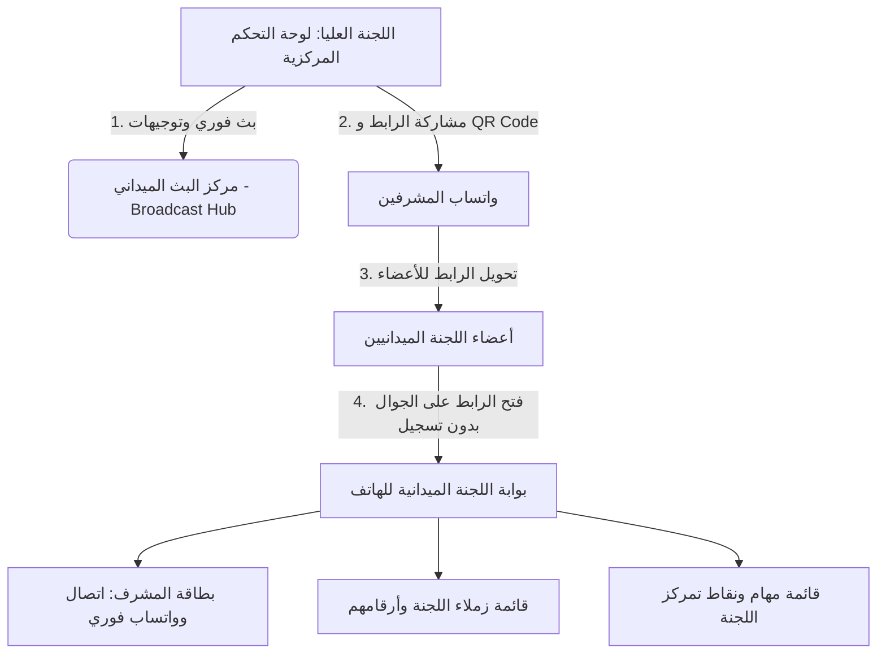

# خطة الحل المتكامل: مركز البث الميداني وبوابات اللجان الذكية (Field Broadcast & Committee Portals)

حل ميداني عملي ومصمم خصيصاً للتغلب على فوضى الاتصالات وصعوبة تعرف أعضاء اللجان على مشرفيهم في أيام الأعراس الجماعية الميدانية المزدحمة.

---

## 🎯 التشخيص وجوهر المشكلة
في أيام الأعراس الجماعية، تتوزع مئات المتطوعين على مناطق جغرافية متباعدة (صالات الطعام، مواقف السيارات، البوابات، مراكب العرسان، منصة الحفل).
- **العضو/المتطوع:** لا يعرف مشرفه المباشر شخصياً، يضيع في الزحام، ولا يعرف من هم زملاؤه في نفس النقطة.
- **اللجنة العليا:** تعاني من فوضى الاتصالات الهاتفية والاجتماعات المستحيلة في الميدان لتوجيه اللجان.

---

## 🏗️ ركائز الحل المعتمدة من جلسة المقابلة (/grill-me)

---

## 📱 1. بوابة اللجنة الميدانية للجوال (Committee Mobile Portal)
رابط سريع وخفيف جداً يُفتح من متصفح الهاتف بنقرة واحدة من واتساب دون الحاجة لإنشاء حساب أو كلمة مرور:

### المميزات الرئيسية في واجهة الجوال:
1. **بطاقة المشرف المباشر (Supervisor Header Card):**
   - اسم المشرف وصورته الرمزية ورتبته الميدانية.
   - زر أخضر بارز: **اتصال فوري (Call Now)**.
   - زر واتساب: **محادثة واتساب فورية (Chat WhatsApp)**.
   - نقطة وموقع تمركز اللجنة (مثال: "البوابة الشرقية - مدخل ضيوف الشرف").
2. **فريق العمل وزملاء اللجنة (Team Roster):**
   - قائمة بأسماء أعضاء اللجنة وتخصصاتهم.
   - أزرار اتصال سريع بكل عضو لتسهيل التعاون الميداني بين الزملاء.
3. **جدول المهام والتكليفات (Task List):**
   - المهام الموكلة للجنة لتكون واضحة لكل عضو في هاتفه لحظة بلحظة.
4. **زر تحميل/حفظ بطاقة تعريفية:**
   - بطاقة رقمية سريعة تثبت انتماء العضو لهذه اللجنة في حال واجه أمن الفعالية أو المنظمين.

---

## 📡 2. مركز البث والتوجيهات للجنة العليا (Central Broadcast Hub)
قسم مخصص في لوحة التحكم المركزية يمنح اللجنة العليا السيطرة الكاملة عبر واتساب بنقرة زر واحدة:

### المميزات الرئيسية:
1. **دليل اتصال المشرفين السريع (Supervisors Directory):**
   - جدول سريع لجميع اللجان يظهر: اسم اللجنة، اسم المشرف، رقم هاتفه، موقعه.
   - زر فوري للاتصال بمشرف اللجنة أو مراسلته على واتساب.
2. **مولد رسائل وبث التوجيهات الموحدة (Broadcast Message Generator):**
   - قوالب جاهزة مسبقاً معدة للأعراس، مثل:
     - 📢 **نداء تجمع وانطلاق اللجان** (مع تذكير بنقاط التمركز).
     - 🚗 **بدء حركة وتفويج الضيوف**.
     - 🍱 **موعد فتح صالات الطعام والوجبات**.
     - ⚠️ **تنبيه عاجل / تعليمات أمنية وتنظيمية**.
     - 🔗 **إرسال رابط بوابة اللجنة للمشرف مع دعوة لمشاركته مع فريقه**.
   - **إمكانية إضافة وحفظ قوالب مخصصة جديدة** خاصة بإدارة العرس لاستخدامها وقت الحاجة.
   - زر يفتح محادثة واتساب مع المشرف بنص التوجيه جاهزاً بضغطة واحدة.
3. **توليد رمز QR ومشاركة الرابط:**
   - زر لكل لجنة: **نسخ الرابط الميداني**.
   - زر: **إرسال الرابط لمشرف اللجنة عبر واتساب**.
   - نافذة **رمز QR Code** جاهز للمسح أو التحميل/الطباعة لوضعه على بطاقات العمل الميدانية.

---

## 🛠️ خطة التنفيذ الفنية (Technical Implementation Plan)

1. **إضافة مولد QR Code:**
   - استخدام مكتبة خفيفة أو واجهة توليد QR متوافقة لعرض رمز الاستجابة السريعة لكل لجنة.
2. **بناء مكون بوابة اللجنة للجوال (`CommitteePortalView`):**
   - دعم التبديل إلى العرض الميداني عبر بارامتر الرابط (مثل `?view=portal&committeeId=...`) أو عبر وضع المعاينة المباشرة من داخل التطبيق.
   - تصميم واجهة متوافقة 100% مع شاشات الهواتف الذكية بتصميم فخم ومريح وسريع التحميل.
3. **بناء مكون مركز البث والتوجيهات (`CommandBroadcastHub`):**
   - دمجه في قسم اللجان بتاب مخصص (بين "إدارة اللجان" و "مركز البث الميداني").
   - توفير القوالب الجاهزة وإمكانية حفظ قوالب جديدة في الذاكرة / `localStorage`.
   - أزرار تفاعلية لإرسال التوجيهات فورياً إلى واتساب المشرفين (`https://wa.me/...`).
4. **تحديث بطاقة تفاصيل اللجنة:**
   - إضافة زر "مشاركة الرابط للمشرف عبر واتساب" وزر "عرض رمز QR" مباشرة في رأس صفحة اللجنة.
